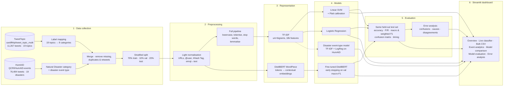

# EventPulse — Intelligent Tweet / Social Media Event Classification System

**MCA AI & ML · Semester III capstone · ETMMTI303 – Language Technologies and Text Intelligence**

EventPulse reads a tweet or social-media post and predicts which real-world **event category** it belongs to
(Natural Disaster, News & Social Concern, Sports & Gaming, Entertainment, Business, Science & Technology,
Health & Fitness, Education, Lifestyle & Daily Life). For disaster tweets it also predicts the **disaster type**
(Earthquake, Hurricane / Cyclone, Flood, Wildfire).

It covers the full NLP workflow: dataset collection → preprocessing → TF-IDF and transformer representations →
classical ML (SVM, Logistic Regression) → fine-tuned DistilBERT → evaluation → error analysis → a Streamlit
dashboard with live and bulk classification.

> All numbers in this README are produced by the code in this repository on the held-out test set. Nothing is
> hard-coded or fabricated; re-running `python run_pipeline.py` regenerates every number and chart.

---

## 1. Problem statement & objectives

Millions of posts are published every hour during elections, matches, product launches and disasters.
Manually sorting them is impossible, yet emergency services, journalists and analysts need to know *what kind of
event* a post is about.

**Objectives**

1. Collect a genuine, labelled public tweet dataset with event-related categories.
2. Build a proper tweet-preprocessing pipeline (URLs, mentions, hashtags, emojis, stop words, lemmatisation).
3. Compare two text representations: sparse **TF-IDF** and contextual **transformer** embeddings.
4. Train classical models (**TF-IDF + SVM**, **TF-IDF + Logistic Regression**) and fine-tune **DistilBERT**.
5. Evaluate all models on the **same unseen test set** (accuracy, precision, recall, macro/weighted F1, confusion matrix).
6. Analyse errors with real misclassified tweets.
7. Ship a professional dashboard for single-tweet, multi-model and CSV bulk classification.

---

## 2. Architecture



---

## 3. Technology stack

| Layer | Tools |
|---|---|
| Language | Python 3.11 (3.10 also supported) in a project-local `.venv` |
| Frontend | Streamlit 1.67 (`st.navigation`, custom theme), custom CSS, Plotly |
| Data | Pandas, NumPy, PyArrow |
| NLP | NLTK (TweetTokenizer, stop words, WordNet lemmatiser), `emoji` |
| Classical ML | scikit-learn (TfidfVectorizer, LinearSVC + CalibratedClassifierCV, LogisticRegression) |
| Deep learning | PyTorch 2.15 (CPU), Hugging Face Transformers 5 (`distilbert-base-uncased`) |
| Persistence | Joblib (classical models), `save_pretrained` (transformer + tokenizer) |
| Testing | pytest + Streamlit `AppTest` |

---

## 4. Dataset

### 4.1 Sources

| Dataset | Hub ID / link | Content | Licence / paper |
|---|---|---|---|
| **TweetTopic** | [`cardiffnlp/tweet_topic_multi`](https://huggingface.co/datasets/cardiffnlp/tweet_topic_multi) | 11,267 English tweets (Sep 2019 – Aug 2021), each annotated by crowd workers with one or more of 19 topics | Antypas et al., *Twitter Topic Classification*, COLING 2022 |
| **HumAID** | [`QCRI/HumAID-events`](https://huggingface.co/datasets/QCRI/HumAID-events) | 76,484 English tweets collected during 19 real natural disasters (2016–2019), annotated with humanitarian categories | Alam et al., *HumAID*, ICWSM 2021 |

Both datasets are downloaded automatically as parquet files from the Hugging Face Hub into `data/raw/`
(`python -m src.data_loader`).

**Why two datasets?** No single public tweet dataset covers *both* general topics (sports, politics, business …)
and natural disasters. TweetTopic has no disaster class, and every disaster dataset (CrisisNLP, CrisisLexT26,
HumAID) contains only crisis tweets. HumAID tweets are genuinely about natural disasters, so they are used *only*
for the **Natural Disaster** category and the disaster-type sub-model. Both datasets are human-annotated English
tweets; Section 4.4 lists the risks of combining them.

### 4.2 Label construction

**TweetTopic → 8 categories.** The 19 fine topics are mapped deterministically (`config/settings.py`):

| Category | TweetTopic topics |
|---|---|
| News & Social Concern | news_&_social_concern (politics, crime, public affairs) |
| Sports & Gaming | sports, gaming |
| Entertainment | music, film_tv_&_video, celebrity_&_pop_culture, arts_&_culture |
| Business | business_&_entrepreneurs |
| Science & Technology | science_&_technology |
| Health & Fitness | fitness_&_health |
| Education | learning_&_educational, youth_&_student_life |
| Lifestyle & Daily Life | diaries_&_daily_life, family, relationships, food_&_dining, fashion_&_style, travel_&_adventure, other_hobbies |

TweetTopic is multi-label, so one primary label is chosen per tweet:

* Tweets whose topics span **more than two** categories are dropped as too ambiguous (656 tweets).
* *Lifestyle & Daily Life* is a **fallback**. A tweet tagged `diaries_&_daily_life` + `news_&_social_concern` is
  labelled News.
* Otherwise the **more specific (less frequent)** category wins, e.g. Business + News → Business.

**HumAID → Natural Disaster.** 2,400 tweets, balanced across the four disaster types and spread over all 19 events.
Tweets HumAID annotators marked `not_humanitarian` (6,296) are excluded because many are not about the disaster.

**Disaster event type.** Derived only from the official HumAID event name (e.g. `kaikoura_earthquake_2016` →
Earthquake). The event-type model uses 24,000 HumAID tweets (6,000 per type) and HumAID's official splits.

### 4.3 Final dataset

| Property | Value |
|---|---|
| Total tweets | **12,999** (10,599 TweetTopic + 2,400 HumAID) |
| Categories | **9** |
| Split (stratified, seed 42) | 9,099 train · 1,300 validation · 2,600 test |
| Missing texts | 0 found |
| Duplicates removed | 1 exact + 9 near-duplicates / retweets (detected on normalised text) |
| Average length | 27.2 words / 166 characters |
| Imbalance ratio | 11.6× (Sports & Gaming 3,021 vs Education 260) |

| Category | Tweets |
|---|---:|
| Sports & Gaming | 3,021 |
| Entertainment | 2,948 |
| Natural Disaster | 2,400 |
| News & Social Concern | 2,398 |
| Lifestyle & Daily Life | 941 |
| Business | 371 |
| Science & Technology | 366 |
| Health & Fitness | 294 |
| Education | 260 |

Processed files: `data/processed/event_tweets.parquet` (+ `.csv`), `data/processed/disaster_event_types.parquet`,
and a cleaning report in `data/processed/data_preparation_report.json`. A real held-out sample for the bulk page is
in `data/samples/sample_test_tweets.csv` (25 test tweets per category, with true labels).

### 4.4 Dataset limitations

* **Composite source.** Natural Disaster tweets come from a different corpus and period (2016–2019) than the
  other categories (2019–2021). URLs, retweet markers and handles are normalised identically for both sources to
  reduce source artefacts, but some stylistic differences remain. This makes the Natural Disaster scores optimistic.
* **TweetTopic's News category** contains some disaster coverage, so News vs Natural Disaster overlaps are real.
* **Small classes.** Business, Science & Technology, Health & Fitness and Education have only 260–371 tweets each.
* **Primary-label choice.** Multi-topic tweets keep only one label, so a prediction of the *other* human topic
  counts as an error.
* No dedicated *Politics* or *Crime* labels exist in the data, so they are part of **News & Social Concern**
  instead of being invented.
* TweetTopic anonymises URLs (`{{URL}}`) and non-verified users (`{{USERNAME}}`); verified accounts appear as
  `{@Name@}`. The original text is kept for display and these markers are normalised for the models.

---

## 5. Preprocessing methodology (`src/preprocessing.py`)

Every tweet keeps three versions: **original** (for display), **text_clean** (for DistilBERT) and
**text_processed** (for TF-IDF).

| Step | DistilBERT input | TF-IDF input |
|---|:-:|:-:|
| HTML entities (`&amp;`), Unicode NFKC, control characters | ✔ | ✔ |
| Remove retweet marker `RT @user:` | ✔ | ✔ |
| Remove URLs (`http…`, `www…`, `{{URL}}`) | ✔ | ✔ |
| Mentions: `@handle`/`{{USERNAME}}` → `@user`; verified `{@NASA@}` → `NASA` | ✔ | ✔ (then dropped) |
| Hashtags: `#HurricaneHarvey` → `Hurricane Harvey` (words are **kept**) | ✔ | ✔ |
| Emojis → words (`🔥` → `fire`) | ✔ | ✔ |
| Lowercasing, Twitter-aware tokenisation (`TweetTokenizer`, elongation reduction) | – (tokenizer is uncased) | ✔ |
| Punctuation / number removal, hyphen splitting | – | ✔ |
| Stop-word removal (NLTK + tweet noise such as `rt`, `amp`) | – | ✔ |
| WordNet lemmatisation (`searching` → `search`, `survivors` → `survivor`) | – | ✔ |

DistilBERT gets natural sentences because stop words, word order and inflection carry context for the
self-attention layers. Aggressive preprocessing would remove that information. The Live Classifier page shows this
pipeline step by step for any tweet.

---

## 6. Text representation

### 6.1 TF-IDF (`src/feature_extraction.py`)
* Unigrams + bigrams (`ngram_range=(1,2)`), `min_df=2`, `max_df=0.9`, `sublinear_tf=True`, max 50,000 features.
  This yields about 18,000 features.
* Fitted on the **training split only** (no leakage) and saved to `models/classical/tfidf_vectorizer.joblib`.

### 6.2 Transformer embeddings
* `distilbert-base-uncased` WordPiece tokenizer (max 96 tokens; 99.9% of tweets fit) → 6 transformer layers →
  768-d contextual [CLS] representation → classification head.

| | TF-IDF | DistilBERT |
|---|---|---|
| Vector | Sparse, one dimension per word/bigram | Dense 768-d, contextual |
| Context | Bigram window only | Whole tweet via self-attention |
| Unseen words | Ignored | Sub-word pieces + pre-trained knowledge |
| Explainability | Exact per-word contribution | Post-hoc (occlusion) |
| Cost | Seconds to train | Tens of minutes on CPU |

---

## 7. Models

### 7.1 TF-IDF + SVM (`src/classical_model.py`)
* `LinearSVC(class_weight="balanced")`, with `C` chosen on the validation split from {0.05, 0.1, 0.25, 0.5, 1}.
* A linear SVM only outputs **decision scores, which are not probabilities**. The final model is therefore wrapped in
  `CalibratedClassifierCV(method="sigmoid", cv=5)` (Platt scaling), and the app shows those calibrated probabilities.

### 7.2 TF-IDF + Logistic Regression
* Multinomial `LogisticRegression(class_weight="balanced")`, with `C` chosen on validation from {1, 2, 5, 10, 20}.

### 7.3 Fine-tuned DistilBERT (`src/transformer_model.py`)
| Hyper-parameter | Value |
|---|---|
| Base model | `distilbert-base-uncased` (66M parameters) |
| Max sequence length | 96 |
| Batch size | 32 (length-grouped batches to reduce padding on CPU) |
| Optimiser | AdamW, lr 5e-5, weight decay 0.01 |
| Schedule | Linear warm-up (10%) then linear decay |
| Epochs | up to 3, early stopping (patience 1) on validation macro-F1 |
| Loss | Cross-entropy with √(inverse-frequency) class weights |
| Hardware | CPU (6 PyTorch threads); CUDA is used automatically if present |

* The best checkpoint (by validation macro-F1) is saved together with its tokenizer in
  `models/transformer/distilbert-event-classifier/`.
* Per-step loss/learning rate and per-epoch train loss, validation loss, accuracy and macro-F1 are logged to
  `reports/evaluation_results/transformer_training_history.json` and plotted on the Model Comparison page.

### 7.4 Disaster event-type model
TF-IDF + Logistic Regression trained on HumAID (Earthquake / Hurricane-Cyclone / Flood / Wildfire). It only runs
for tweets classified as Natural Disaster.

### 7.5 Explanations ("important keywords")
* TF-IDF models: **tf-idf weight × class coefficient** per term. For linear models this is an exact decomposition
  of the class score.
* DistilBERT: **occlusion**. Each word is removed in turn and the drop in the predicted class probability is measured.

---

## 8. Evaluation & results

All models are evaluated on the **same 2,600-tweet test split**, which is never used for training or for choosing
hyper-parameters. Inference time covers preprocessing + prediction for the whole test set, divided by the number
of tweets, measured on the development laptop's CPU (12 logical cores, no GPU used).

### 8.1 Overall comparison (test set, 2,600 tweets)

| Model | Accuracy | Precision (macro) | Recall (macro) | **Macro F1** | Weighted F1 | Training time | Inference |
|---|---:|---:|---:|---:|---:|---:|---:|
| TF-IDF + SVM (calibrated) | 0.7912 | 0.7002 | 0.5861 | 0.6206 | 0.7802 | 1.9 s | 1.04 ms/tweet |
| TF-IDF + Logistic Regression | 0.7835 | 0.6708 | 0.6282 | 0.6435 | 0.7817 | 15.3 s | 0.94 ms/tweet |
| **DistilBERT (fine-tuned)** | **0.8308** | **0.7146** | **0.7159** | **0.7141** | **0.8310** | 46.1 min (CPU) | 48.6 ms/tweet |

(Classical training times include TF-IDF fitting; the SVM time includes 5-fold calibration. The `C` grid search on
the validation set is not counted.)

### 8.2 F1-score per category

| Category | Test tweets | SVM | LogReg | DistilBERT |
|---|---:|---:|---:|---:|
| Natural Disaster | 480 | **0.974** | 0.967 | 0.967 |
| Sports & Gaming | 604 | 0.871 | 0.868 | **0.928** |
| Entertainment | 590 | 0.791 | 0.793 | **0.839** |
| News & Social Concern | 480 | 0.749 | 0.726 | **0.771** |
| Lifestyle & Daily Life | 188 | 0.531 | 0.570 | **0.668** |
| Education | 52 | 0.384 | 0.482 | **0.590** |
| Science & Technology | 73 | 0.523 | 0.542 | **0.567** |
| Business | 74 | 0.385 | 0.423 | **0.565** |
| Health & Fitness | 59 | 0.378 | 0.421 | **0.531** |

### 8.3 DistilBERT training curve

| Epoch | Train loss | Val loss | Val accuracy | Val macro-F1 | Time |
|---:|---:|---:|---:|---:|---:|
| 1 | 1.154 | 0.823 | 0.798 | 0.641 | 15.5 min |
| 2 | 0.544 | **0.761** | 0.826 | 0.668 | 15.3 min |
| 3 | 0.323 | 0.774 | 0.824 | **0.680** | 15.2 min |

The checkpoint from epoch 3 (best validation macro-F1) is used. Validation loss rose slightly in epoch 3 while
training loss kept falling. This early sign of overfitting is why training stops at 3 epochs with early stopping.

### 8.4 Disaster event-type model

| Evaluation | Accuracy | Macro F1 |
|---|---:|---:|
| HumAID official test split (same 19 events as training, 4,801 tweets) | 0.976 | 0.976 |
| 5-fold cross-validation **grouped by event** (test disasters never seen in training) | 0.745 | 0.750 |

The large gap shows that the model partly memorises event-specific words (place names, storm names). The grouped
score is the realistic one for a brand-new disaster.

### 8.5 Interpretation

* **DistilBERT is the most accurate model** (+4 points accuracy, +7 to +9 points macro-F1 over the classical
  models). The biggest gains are on small and ambiguous classes (Business +0.18, Education +0.21, Health +0.15 F1
  vs. SVM). These are the classes where context and pre-trained knowledge help most when training examples are
  few.
* **The transformer is not better everywhere.** On Natural Disaster the SVM is slightly better (0.974 vs 0.967).
  Disaster tweets contain strong keywords ("earthquake", "flood", "evacuate") that a linear model on TF-IDF
  captures perfectly.
* **SVM vs Logistic Regression.** The SVM has higher accuracy and precision; Logistic Regression has higher macro
  recall and macro-F1. The SVM favours the large classes.
* **Cost.** DistilBERT needed 46 minutes of CPU training and is about 50× slower per tweet (49 ms vs 1 ms). For
  large-scale real-time filtering, TF-IDF + SVM remains a strong, cheap baseline.
* **Confidence calibration.** DistilBERT's mean confidence (0.90) is higher than its accuracy (0.83): it made 220
  errors with ≥ 80% confidence, against 32 for the Platt-calibrated SVM. Treat its probabilities as rankings, not as
  calibrated likelihoods; temperature scaling would be a natural next step.
* **Weak categories** for every model are Health & Fitness, Business, Science & Technology and Education. They
  are the smallest classes (52–74 test tweets) and overlap semantically with News and Lifestyle.

---

## 9. Error analysis

The **Error Analysis** page shows misclassified test tweets with actual/predicted label, confidence, the probability
given to the true class, and *possible* causes. These are detected with transparent heuristics: short tweet,
multi-topic tweet, semantically similar categories, hashtag-heavy text, out-of-vocabulary words (slang, names,
misspellings), humour/sarcasm cues, non-English text, low confidence. It also shows:

* error rate per category and the most frequent actual → predicted confusions;
* error rate vs. tweet length and vs. the number of human topics;
* correct predictions (most and least confident);
* tweets where two models disagree, and which one was right.

**Findings for DistilBERT (440 errors, 16.9% of the test set):**

| Indicator | Misclassified tweets |
|---|---:|
| Confused pair is semantically related (e.g. Entertainment ↔ Lifestyle, News ↔ Health) | 301 |
| Multi-topic tweet (annotators gave ≥ 2 topics) | 272 |
| Low model confidence (< 50%) | 74 |
| Hashtag-heavy | 42 |
| Implicit context (no indicator found) | 37 |

* **Multi-topic tweets are about twice as hard.** Error rate is 13.0% for TweetTopic tweets with one human topic,
  28.0% with two and 29.3% with three or more. Many "errors" predict the tweet's *other* valid topic.
* **Top confusions:** Entertainment → Lifestyle (37), News → Entertainment (35, mostly celebrity/activism news),
  Entertainment → News (28), Lifestyle → Entertainment (23), Sports → Entertainment (22, e-sports/streaming),
  News → Health (20, COVID-19 news).
* **Very short tweets (1–4 tokens)** have the highest error rate (26.7%, only 15 tweets), but most errors happen in
  normal-length tweets. Ambiguity matters more than length.
* **SVM vs DistilBERT disagree on 472 test tweets.** DistilBERT is right in 235 of them, the SVM in 132, and
  neither in 105. Typical DistilBERT wins are tweets that need context; typical SVM wins are keyword-heavy tweets.
* Sarcasm cues and out-of-vocabulary words are rare in the errors (< 10 tweets each). Overlapping categories and
  label ambiguity dominate.

---

## 10. The dashboard

| Page | What it shows |
|---|---|
| **Overview** | Project summary, dataset KPIs, category distribution, NLP pipeline, model leaderboard, recent predictions, quick navigation |
| **Live Classifier** | Tweet input, example and random test tweets, model choice (SVM / LogReg / DistilBERT / compare), result card with confidence, all class probabilities, keyword importance, disaster type, preprocessing walkthrough |
| **Bulk Analysis** | CSV upload (or the sample file), column selection, validation, batched processing with a progress bar, distribution and confidence charts, filterable results, accuracy against an optional ground-truth column, CSV download |
| **Event Analytics** | Filters (category/source/split), tweets per category, imbalance, frequent words & hashtags, keyword treemap, length distributions, category comparison, data-quality report |
| **Model Comparison** | Metrics table, grouped metric bars, training & inference time, per-category F1, findings computed from the results, DistilBERT loss/LR curves, SVM/LogReg tuning grids, TF-IDF vs transformer comparison |
| **Model Evaluation** | Confusion matrix (counts or row-%), classification report, precision–recall bubble chart, F1 per category, confidence vs correctness, event-type model incl. unseen-event CV |
| **Error Analysis** | Error patterns, misclassified tweet browser with causes, correct predictions, model disagreements |

The UI uses a dark navy theme with blue/cyan accents (`.streamlit/config.toml` + `assets/custom.css`). Surface
colours are derived from `currentColor`, so the layout also stays readable if Streamlit's built-in Light theme is
selected from the ⋮ → Settings menu. Every prediction is logged to `logs/prediction_history.csv`, which powers
"Predictions made" and "Recent activity" on the Overview page.

---

## 11. Installation & execution

### Windows PowerShell (from the project root)

```powershell
python -m venv .venv
.\.venv\Scripts\Activate.ps1
python -m pip install --upgrade pip
python -m pip install -r requirements.txt
streamlit run app.py
```

If PowerShell blocks activation, run `Set-ExecutionPolicy -Scope CurrentUser RemoteSigned` once.
Use Python 3.10 or 3.11 (`py -3.11 -m venv .venv` if several versions are installed). Check that the venv is
active with `python -c "import sys; print(sys.executable)"`; it must point inside `.venv`.

### Linux / WSL

```bash
python3 -m venv .venv
source .venv/bin/activate
python -m pip install --upgrade pip
# optional, avoids the 2.5 GB CUDA build on Linux:
python -m pip install torch==2.15.0 --index-url https://download.pytorch.org/whl/cpu
python -m pip install -r requirements.txt
streamlit run app.py
```

### Re-creating data, models and results

The repository already contains the processed dataset, the classical models and the evaluation results. The
DistilBERT weights (≈255 MB) are git-ignored and must be trained once:

```bash
python run_pipeline.py                     # everything: data → explore → classical → DistilBERT → evaluate
python run_pipeline.py --skip-transformer  # fast (~1 min): no DistilBERT
python run_pipeline.py --only transformer evaluate
```

Individual steps: `python -m src.data_loader`, `python -m src.data_exploration`, `python -m src.classical_model`,
`python -m src.transformer_model`, `python -m src.evaluation`.

Downloads stay inside the project: datasets → `data/raw/`, Hugging Face models → `.hf_cache/`, NLTK data → `nltk_data/`.
The app works without DistilBERT: it shows DistilBERT as "Not trained" and uses the classical models.

### Tests

```bash
python -m pytest tests -v
```

**Result: 40 passed** (Python 3.11.17, CPU). The suite covers:

| File | What is tested |
|---|---|
| `test_preprocessing.py` (11) | URL / mention / hashtag / emoji handling, retweet removal, stop words, lemmatisation, empty input, duplicate key, pipeline trace |
| `test_classical_model.py` (6) | TF-IDF n-grams, linear explanations, training on a toy set, saved SVM/LogReg give valid probabilities and correct labels for the two brief examples, event-type model |
| `test_prediction.py` (7) | Prediction service (probabilities sum to 1, keywords, event type), input validation, DistilBERT prediction, prediction log |
| `test_bulk_prediction.py` (7) | CSV parsing, Latin-1 fallback, empty file, row cap, validation, batched classification with empty rows, compare mode |
| `test_app_pages.py` (9) | Every dashboard page renders headlessly without exceptions; clicking *Analyze* on the live page; full bulk flow on the sample CSV |

### VS Code
`.vscode/settings.json` points the interpreter at `.venv` and enables pytest; `.vscode/launch.json` has a
"Streamlit: app.py" debug configuration. On Windows, choose *Python: Select Interpreter → .venv\Scripts\python.exe*
once.

---

## 12. Project structure

```
├── app.py                      # Streamlit entry point (navigation, theme, sidebar status)
├── run_pipeline.py             # one-command pipeline
├── requirements.txt
├── config/settings.py          # paths, label mapping, hyper-parameters, colours
├── src/
│   ├── data_loader.py          # download, label mapping, cleaning, split
│   ├── data_exploration.py     # EDA statistics
│   ├── preprocessing.py        # tweet normalisation & classical NLP pipeline
│   ├── feature_extraction.py   # TF-IDF + linear explanations
│   ├── classical_model.py      # SVM, Logistic Regression, event-type model
│   ├── transformer_model.py    # DistilBERT fine-tuning & inference (+ occlusion)
│   ├── prediction.py           # prediction service + prediction log
│   ├── bulk_prediction.py      # CSV reading, validation, batched classification
│   ├── evaluation.py           # metrics on the shared test set
│   ├── error_analysis.py       # error statistics & heuristic causes
│   ├── visualization.py        # Plotly chart builders
│   └── ui.py                   # Streamlit components, caching, guards
├── pages/                      # 0_Overview … 6_Error_Analysis
├── assets/                     # custom.css, logo
├── .streamlit/config.toml      # theme
├── data/{raw,processed,evaluation,samples}/
├── models/{classical,transformer}/
├── reports/evaluation_results/ # metrics.json, classification reports, training history
├── logs/                       # training log, prediction history
└── tests/                      # pytest + Streamlit AppTest
```

---

## 13. Limitations & future work

* The **Natural Disaster** class comes from a separate corpus, which makes it the easiest class. A single corpus
  covering all event types would give a cleaner benchmark.
* Small categories (Business, Science & Technology, Health, Education) still have F1 well below the large ones.
  More data or data augmentation would help.
* The disaster event-type model scores much lower on unseen disasters than on the official split (see §8). It
  learns event-specific names such as "Harvey" and "Kerala".
* Single-label output for multi-topic tweets; a multi-label head would be more faithful to TweetTopic.
* English only; sarcasm and code-mixed text remain hard.
* Error-cause detection uses heuristics. It gives indications, not proof.

---

## 14. References

1. D. Antypas, A. Ushio, J. Camacho-Collados, L. Neves, V. Silva, F. Barbieri. *Twitter Topic Classification.* COLING 2022.
2. F. Alam, U. Qazi, M. Imran, F. Ofli. *HumAID: Human-Annotated Disaster Incidents Data from Twitter.* ICWSM 2021.
3. V. Sanh, L. Debut, J. Chaumond, T. Wolf. *DistilBERT, a distilled version of BERT.* 2019.
4. J. Platt. *Probabilistic outputs for support vector machines.* 1999.
